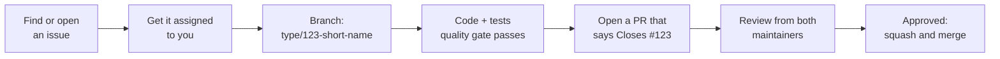

<div align="center">


# Contributing to the Dreep MCP server

</div>

Thank you for helping improve the Dreep MCP server. This guide covers everything from finding
something to work on to getting your pull request merged.

## The contribution flow at a glance



**Every pull request must be linked to an issue, and must be reviewed by both maintainers.**
That way each change has an agreed purpose before anyone writes code, and nothing is
merged without review.

| Maintainer | GitHub |
| :- | :- |
| Abe Toluwani | [abetoluwani](https://github.com/abetoluwani) |
| Precious Orjiude (Indigo) | [IndigoSoftwares21](https://github.com/IndigoSoftwares21) |

## 1. Start with an issue

- **Found a bug?** Search the [open issues](https://github.com/IndigoSoftwares21/dreep-mcp/issues)
  first. If it isn't there, [file a bug report](https://github.com/IndigoSoftwares21/dreep-mcp/issues/new?template=bug_report.yml)
  with the server version, your MCP client, and the tool call that shows the problem.
- **Want a feature?** [Open a feature request](https://github.com/IndigoSoftwares21/dreep-mcp/issues/new?template=feature_request.yml)
  that describes the problem you're trying to solve, not only the solution you have in mind.
- **Want to help but don't have an idea?** Look for issues labelled
  [`good first issue`](https://github.com/IndigoSoftwares21/dreep-mcp/labels/good%20first%20issue)
  or [`help wanted`](https://github.com/IndigoSoftwares21/dreep-mcp/labels/help%20wanted).

Comment on the issue to say you'd like to take it, and wait until a maintainer assigns it
to you before you start. That way two people don't build the same thing, and the approach
is agreed before you write code.

> [!NOTE]
> Security problems are the exception: never report them in a public issue. See
> [SECURITY.md](SECURITY.md).

## 2. Set up your environment

```bash
gh repo fork IndigoSoftwares21/dreep-mcp --clone   # or: git clone, if you're a collaborator
cd dreep-mcp
bash scripts/setup_hooks.sh
```

`setup_hooks.sh` creates `.venv`, installs the server with its development tools, and turns
on the git hooks in `.githooks/`. The hooks run the quality gate before every commit, so
problems show up on your machine, not in review.

## 3. Create a branch for the issue

Name the branch `<type>/<issue-number>-<short-description>`, in lowercase kebab-case:

```bash
git switch -c feature/42-video-thumbnail-tool
```

| Type | Use it for |
| :- | :- |
| `feature/` | New capability |
| `bugfix/` | Fixing incorrect behaviour |
| `hotfix/` | Urgent fix for a released version |
| `refactor/` | Restructuring without changing behaviour |
| `docs/` | Documentation only |
| `chore/`, `ci/` | Tooling, dependencies, workflows |
| `release/` | Preparing a release |

## 4. Make the change

### How the code is organised

| Where | What lives there |
| :- | :- |
| `src/dreep_mcp/_tools_*.py` | The tools, one module per group. **Most changes land here.** |
| `src/dreep_mcp/_params.py`, `_transform_input.py` | Parameter schemas the agent reads |
| `src/dreep_mcp/_tool_call.py` | The one place SDK calls are awaited and their errors mapped |
| `src/dreep_mcp/_server.py` | Builds the server and registers the tool groups |
| `src/dreep_mcp/_cli.py` | The command and the stdio and HTTP transports |
| `src/dreep_mcp/_constants.py` | Every value that affects behaviour |
| `npm/` | The `npx` launcher (Node, no dependencies) |
| `tests/` | Tests, through a real MCP client against a mocked Dreep API (no network) |
| `scripts/rules/` | The repository rules (one file per rule) |

[AGENTS.md](AGENTS.md) has the full architecture and the reasons behind it.

### Adding or changing a tool

1. If the Dreep API gained the capability, add it to the
   [`dreep` Python SDK](https://github.com/IndigoSoftwares21/dreep-python) first. Tools
   never call the HTTP API directly.
2. Add the tool to the matching `_tools_*.py` module, inside its `register_*_tools`
   function. Reuse the shared parameters in `_params.py`, make every argument
   keyword-only, and wrap the SDK call in `run(...)` so errors reach the agent.
3. Give it the right annotation from `_annotations.py` (`READ`, `LOCAL`, `CREATE` or
   `DELETE`). A destructive tool must only be registered when `settings.allow_delete` is set.
4. Write its docstring for the agent: what it does, what it returns, and any rule the API
   enforces. That docstring is the tool description the model reads.
5. Add tests in `tests/test_tools_*.py` that call it through the MCP client, and update
   the tool count in `tests/test_server.py`.
6. Document it in the README's tool table and add a line under **Unreleased** in
   `CHANGELOG.md`.

### House rules

These are enforced automatically: a commit that breaks them is stopped by the hooks.

- **No magic strings.** Put behaviour-affecting values in the owning constants module.
- **DRY.** Don't repeat a block of logic; extract it.
- **Small files.** Over 200 lines warns; over 400 fails.
- **Layering.** Only `_cli.py` may run an event loop or web server, or construct a client.
- **Every suppression explains itself:** `# type: ignore[code]`, `# noqa: CODE`,
  `# allow-magic: reason`.
- **Tests come with every behaviour change.** A bug fix includes a test that would have
  caught the bug.

### Run the quality gate

```bash
bash scripts/quality_gate.sh
```

It runs, in order:
1. ruff lint and format
2. Repository rules
3. `mypy --strict`
4. pytest, with coverage of at least 90%
5. The npm launcher's tests (`node --test`)

The pre-commit hook runs the same gate, and so does CI.

## 5. Commit

Use [Conventional Commits](https://www.conventionalcommits.org), with lines of at most 100
characters, and sign your commits:

```text
feat(tools): add a video thumbnail tool

Agents asked for poster frames often enough to deserve their own tool.

Closes #42
```

Types: `feat`, `fix`, `refactor`, `perf`, `test`, `docs`, `style`, `build`, `ci`,
`chore`, `revert`. The commit-msg hook checks the format.

If you haven't set up commit signing yet, see
[GitHub's guide](https://docs.github.com/en/authentication/managing-commit-signature-verification/signing-commits).

## 6. Open a pull request, linked to the issue

```bash
git push -u origin feature/42-video-thumbnail-tool
gh pr create --fill --reviewer abetoluwani,IndigoSoftwares21
```

The PR template asks for:

- **The linked issue.** Write `Closes #42` (or `Fixes #42`) in the description. GitHub then
  closes the issue when the PR merges. A CI check fails any PR that isn't linked to an
  issue.
- **Reviewers.** Request review from both maintainers: **Abe Toluwani
  ([abetoluwani](https://github.com/abetoluwani))** and **Indigo
  ([IndigoSoftwares21](https://github.com/IndigoSoftwares21))**. CODEOWNERS requests them
  automatically, but check that both are listed.
- **What changed and how you tested it.**

Keep each PR focused on its issue. Unrelated clean-ups belong in their own issue and PR.

## 7. Review and merge

- Both maintainers review. Answer each comment with either a change or a reply, then
  re-request review.
- CI must be green: the quality gate on Python 3.10 to 3.14, the npm launcher tests, plus the issue-link check.
- After **both maintainers approve**, a maintainer squash-merges the PR. The squashed
  commit keeps your Conventional Commit title.
- Don't push directly to `main` or rewrite its history. The pre-push hook blocks both.

## Releasing (maintainers)

1. Open a `release/x.y.z` PR that bumps the version in **both** `src/dreep_mcp/_version.py`
   and `npm/package.json`, and moves the **Unreleased** notes in `CHANGELOG.md` under the
   new version. The release workflow refuses a tag that doesn't match both.
2. Merge it with both approvals.
3. Tag the merge commit and push the tag:
   ```bash
   git tag -s vX.Y.Z -m "vX.Y.Z"
   git push origin vX.Y.Z
   ```
4. The release workflow tests and builds the package, publishes it to PyPI, publishes the
   launcher to npm (both with trusted publishing, no stored tokens), and creates the
   GitHub Release.

## Getting help

Ask on the issue you're working on, or open a
[discussion issue](https://github.com/IndigoSoftwares21/dreep-mcp/issues/new). For
questions about the Dreep API itself, see the [Dreep docs](https://docs.dreep.cloud).
