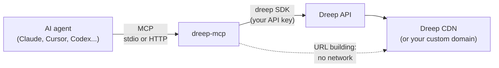

<div align="center">

<a href="https://dreep.cloud">
  
</a>

<h1>Dreep MCP Server</h1>

<p><strong>Give any AI agent a media pipeline.</strong><br>
The official <a href="https://modelcontextprotocol.io">Model Context Protocol</a> server for
<a href="https://dreep.cloud">Dreep</a>: upload, transform, convert, OCR and deliver images,
videos and documents from Claude, Cursor, VS Code, Codex, Gemini and every other MCP client.</p>

[](https://pypi.org/project/dreep-mcp/)
[](https://www.npmjs.com/package/dreep-mcp)
[](https://github.com/IndigoSoftwares21/dreep-mcp/actions/workflows/ci.yml)
[](https://modelcontextprotocol.io)
[](LICENSE)

[Dreep docs](https://docs.dreep.cloud) ·
[API reference](https://docs.dreep.cloud/api-reference/upload/upload-media) ·
[Python SDK](https://github.com/IndigoSoftwares21/dreep-python) ·
[Changelog](CHANGELOG.md) ·
[Report a bug](https://github.com/IndigoSoftwares21/dreep-mcp/issues/new?template=bug_report.yml)

</div>

---

Ask your agent things like:

> *"Upload `~/Desktop/launch/hero.png` to `marketing/2026` and give me a 1200px WebP and a 400px square thumbnail."*
>
> *"Pull the text out of this scanned invoice."*
>
> *"Convert `contract.docx` to PDF and give me a link that expires in an hour."*
>
> *"Cut the background out of `product.jpg` and show it on white."*

## Contents

- [How it works](#how-it-works)
- [Quick start](#quick-start)
- [Add it to your client](#add-it-to-your-client): [Claude Desktop](#claude-desktop) · [Claude Code](#claude-code) · [Cursor](#cursor) · [VS Code](#vs-code-github-copilot) · [Windsurf](#windsurf) · [Codex CLI](#openai-codex-cli) · [Gemini CLI](#gemini-cli) · [Zed](#zed) · [Cline and others](#cline-and-other-clients) · [Remote (HTTP)](#remote-clients-over-http)
- [Tools](#tools)
- [Configuration](#configuration)
- [Security](#security)
- [Development](#development)

## How it works



1. Your MCP client starts `dreep-mcp` on your machine (stdio), or connects to one you host (streamable HTTP).
2. The agent sees 14 tools (16 with deletes enabled), each with a typed JSON schema that lists every valid transform value, so it calls them correctly the first time.
3. Each tool calls the official Dreep SDK ([Node](https://github.com/IndigoSoftwares21/dreep-js) or [Python](https://github.com/IndigoSoftwares21/dreep-python)), which talks to the Dreep API with your key. Delivery and signed URLs are built locally, with no API call.
4. Results come back as structured JSON. Every asset carries the delivery `url` exactly as Dreep returned it, custom CDN domain included.

There are two native servers, one for Node and one for Python, so you only need the runtime you already have. They expose the same tools: the Python server exports its tool names, descriptions and input schemas to [`npm/contract/tools.json`](npm/contract/tools.json), the Node server serves that file, and CI fails if it goes stale. The [one known difference](#tools) comes from the Node SDK.

## Quick start

1. Create an API key on the **API Keys** page of the [Dreep dashboard](https://dreep.cloud).
2. Add the server to your client (below). Pick whichever runtime you already have:

   | Runner | Command | Needs |
   | :- | :- | :- |
   | **npx** | `npx -y dreep-mcp` | Node 20+ |
   | **uvx** | `uvx dreep-mcp` | [uv](https://docs.astral.sh/uv/) |
   | **pip** | `pip install dreep-mcp`, then `dreep-mcp` | Python 3.10+ |

   The examples below use `npx`. To use uvx instead, swap `"command": "npx", "args": ["-y", "dreep-mcp"]` for `"command": "uvx", "args": ["dreep-mcp"]`.

## Add it to your client

Every client needs the same three things: a command (`npx`), its arguments (`-y dreep-mcp`), and your API key in the `DREEP_API_KEY` environment variable. Replace `drp_live_your_key` with your key. Add `DREEP_SIGNING_SECRET` if you use signed folders, and `DREEP_MCP_ALLOW_DELETE` if you want the delete tools (see [Configuration](#configuration)).

### Claude Desktop

Open **Settings → Developer → Edit Config**, which opens `claude_desktop_config.json`:

- macOS: `~/Library/Application Support/Claude/claude_desktop_config.json`
- Windows: `%APPDATA%\Claude\claude_desktop_config.json`

```json
{
  "mcpServers": {
    "dreep": {
      "command": "npx",
      "args": ["-y", "dreep-mcp"],
      "env": {
        "DREEP_API_KEY": "drp_live_your_key",
        "DREEP_SIGNING_SECRET": "your_signing_secret"
      }
    }
  }
}
```

Restart Claude Desktop. **Dreep** appears under the tools (slider) icon in the message box.

> If Claude Desktop can't find `npx`, use its full path (run `which npx`). GUI apps don't always inherit your shell's `PATH`, which is common with nvm.

### Claude Code

```bash
claude mcp add dreep --scope user -e DREEP_API_KEY=drp_live_your_key -- npx -y dreep-mcp
```

`--scope user` makes it available in every project; leave it out to add it to the current project only, or use `--scope project` to share it with your team through `.mcp.json` (keep the key out of that file, as shown below). Check it with `claude mcp list`, or `/mcp` inside a session.

To share the setup in a repository without committing the key, put this in `.mcp.json` and let each person export `DREEP_API_KEY` in their own shell:

```json
{
  "mcpServers": {
    "dreep": {
      "command": "npx",
      "args": ["-y", "dreep-mcp"],
      "env": { "DREEP_API_KEY": "${DREEP_API_KEY}" }
    }
  }
}
```

### Cursor

Open **Cursor Settings → MCP → Add new MCP server**, or edit `~/.cursor/mcp.json` (all projects) or `.cursor/mcp.json` (one project):

```json
{
  "mcpServers": {
    "dreep": {
      "command": "npx",
      "args": ["-y", "dreep-mcp"],
      "env": { "DREEP_API_KEY": "drp_live_your_key" }
    }
  }
}
```

The Dreep tools are then available to the agent in chat.

### VS Code (GitHub Copilot)

Create `.vscode/mcp.json`. VS Code asks for the key the first time and stores it securely:

```json
{
  "inputs": [
    {
      "type": "promptString",
      "id": "dreep-api-key",
      "description": "Dreep API key",
      "password": true
    }
  ],
  "servers": {
    "dreep": {
      "type": "stdio",
      "command": "npx",
      "args": ["-y", "dreep-mcp"],
      "env": { "DREEP_API_KEY": "${input:dreep-api-key}" }
    }
  }
}
```

Open Copilot Chat in **Agent** mode and pick the Dreep tools from the tools menu.

### Windsurf

Open **Windsurf Settings → Cascade → MCP Servers → View raw config**, or edit `~/.codeium/windsurf/mcp_config.json`:

```json
{
  "mcpServers": {
    "dreep": {
      "command": "npx",
      "args": ["-y", "dreep-mcp"],
      "env": { "DREEP_API_KEY": "drp_live_your_key" }
    }
  }
}
```

### OpenAI Codex CLI

Add to `~/.codex/config.toml`:

```toml
[mcp_servers.dreep]
command = "npx"
args = ["-y", "dreep-mcp"]
env = { DREEP_API_KEY = "drp_live_your_key" }
```

### Gemini CLI

Add to `~/.gemini/settings.json` (or `.gemini/settings.json` in a project):

```json
{
  "mcpServers": {
    "dreep": {
      "command": "npx",
      "args": ["-y", "dreep-mcp"],
      "env": { "DREEP_API_KEY": "drp_live_your_key" }
    }
  }
}
```

### Zed

Add to Zed's `settings.json` (**Zed → Settings → Open Settings**):

```json
{
  "context_servers": {
    "dreep": {
      "command": "npx",
      "args": ["-y", "dreep-mcp"],
      "env": { "DREEP_API_KEY": "drp_live_your_key" }
    }
  }
}
```

### Cline and other clients

Cline (**MCP Servers → Configure**), Roo Code, Continue, Goose, JetBrains AI Assistant, LM Studio and most other clients take the same `mcpServers` block shown for [Cursor](#cursor). Anything that can launch a stdio MCP server can run `npx -y dreep-mcp` with `DREEP_API_KEY` set.

### Remote clients over HTTP

For web-based agents, shared team servers or containers, run the streamable HTTP transport:

```bash
export DREEP_API_KEY=drp_live_your_key
export DREEP_MCP_HTTP_TOKEN="$(openssl rand -hex 32)"
npx -y dreep-mcp --transport http --host 0.0.0.0 --port 8000
```

The endpoint is `http://<host>:8000/mcp`, and every request must send `Authorization: Bearer <DREEP_MCP_HTTP_TOKEN>`. Put it behind HTTPS (a reverse proxy or your platform's load balancer) before exposing it. Then connect, for example from Claude Code:

```bash
claude mcp add --transport http dreep https://mcp.example.com/mcp --header "Authorization: Bearer $DREEP_MCP_HTTP_TOKEN"
```

Without `--host` it binds to `127.0.0.1`, and it refuses to bind to any other address unless `DREEP_MCP_HTTP_TOKEN` is set. Over HTTP the tools can't read files on the server unless you allow specific directories with `DREEP_MCP_FILE_ROOTS`; remote callers send files as `content_base64` instead.

## Tools

| Tool | What it does | Kind |
| :- | :- | :- |
| `upload_file` | Uploads an image, video, audio file or document from a local path or base64 content, optionally transforming it before storage. Files over 100 MB stream straight to storage. | writes |
| `create_upload_url` | Starts a presigned upload for bytes the server can't read (PUT them, then confirm). | writes |
| `confirm_upload` | Finalises a presigned upload and returns the asset. | writes |
| `list_media` | Lists assets with pagination, filtered by folder. | read-only |
| `remove_background` | Cuts the subject out of an image and stores a transparent PNG or WebP. | writes |
| `extract_text` | OCR for images and PDFs. On the Python server, optionally with line blocks and bounding boxes (`include_blocks`). | writes |
| `convert_document` | Word ↔ PDF, Excel, PowerPoint, CSV, or a PDF page to PNG/JPEG. | writes |
| `build_delivery_url` | Resize, crop, convert, compress, blur, round or trim an asset at the CDN. | local, no network |
| `build_signed_url` | A time-limited link for an asset in a signed folder. | local, no network |
| `create_folder` | Creates a folder or a whole path, with access control (`public`, `private`, `signed`) on top-level folders. | writes |
| `list_folders` | Lists folders with their paths and access control. | read-only |
| `create_preset` | Saves a named transform for reuse. | writes |
| `list_presets` | Lists saved presets. | read-only |
| `get_usage` | Storage used and image, file and folder counts. | read-only |
| `delete_media` | Permanently deletes an asset. **Only when `DREEP_MCP_ALLOW_DELETE` is set.** | destructive |
| `delete_preset` | Deletes a preset. **Only when `DREEP_MCP_ALLOW_DELETE` is set.** | destructive |

Every tool carries MCP [annotations](https://modelcontextprotocol.io/docs/concepts/tools#tool-annotations): read-only tools are marked so clients can run them without asking, and delete tools are marked destructive so clients ask you first.

A few behaviours come straight from the [API reference](https://docs.dreep.cloud), verified against the live API:

- **Use URLs as returned.** Projects can serve assets from a custom CDN domain, so the tools never construct a delivery URL from scratch; they transform the one Dreep returned.
- **Signed URLs sign the asset and expiry only** (`HMAC-SHA256` over `"{id}:{exp}"`). Transform parameters ride along unsigned.
- **Access control is set on top-level folders**; nested folders inherit it. The API has no endpoint for deleting folders.
- **Presets need a `format`**, and preset keys may only contain lowercase letters, digits and underscores.

## Configuration

| Variable | Required | Purpose |
| :- | :- | :- |
| `DREEP_API_KEY` | yes | Your project API key. |
| `DREEP_SIGNING_SECRET` | for signed URLs | The URL Signing Secret from the dashboard's API Keys page. |
| `DREEP_MCP_ALLOW_DELETE` | no | `1` registers `delete_media` and `delete_preset`. Off by default. |
| `DREEP_MCP_FILE_ROOTS` | no | Directories the file tools may read, separated by `:` (`;` on Windows). Unset over stdio means any file you can read; unset over HTTP means none. |
| `DREEP_MCP_HTTP_TOKEN` | for public HTTP | Bearer token every HTTP request must present. |

Command-line options:

```text
dreep-mcp [--transport {stdio,http}] [--host HOST] [--port PORT] [--path PATH]
```

| Option | Default |
| :- | :- |
| `--transport` | `stdio` |
| `--host` | `127.0.0.1` |
| `--port` | `8000` |
| `--path` | `/mcp` |

## Security

- **Your API key can read, upload and delete everything in the project.** It stays in the server's environment and is sent only to the Dreep API, never to the agent.
- **Deletes are off unless you turn them on**, and are marked destructive so clients confirm them.
- **File access is scoped.** Restrict which directories the agent can upload from with `DREEP_MCP_FILE_ROOTS`. Over HTTP, local file reads are off unless you set it.
- **The HTTP transport binds to localhost by default** and refuses a public address without `DREEP_MCP_HTTP_TOKEN`. Tokens are compared in constant time.
- **Signed URLs are bearer tokens.** Anyone with the link can fetch the asset until it expires.

Report vulnerabilities privately; see [SECURITY.md](SECURITY.md).

## Development

```bash
git clone https://github.com/IndigoSoftwares21/dreep-mcp.git
cd dreep-mcp
bash scripts/setup_hooks.sh      # venv, dev dependencies, git hooks
bash scripts/quality_gate.sh     # lint, format, repository rules, mypy --strict, Python and Node tests
```

Try your local checkout in a client by pointing it at the venv: `"command": "/path/to/dreep-mcp/.venv/bin/dreep-mcp"`. To poke at the tools interactively, run the [MCP Inspector](https://github.com/modelcontextprotocol/inspector):

```bash
npx @modelcontextprotocol/inspector .venv/bin/dreep-mcp
```

The layout:

| Path | What lives there |
| :- | :- |
| `src/dreep_mcp/_tools_*.py` | The Python server: one module per tool group |
| `src/dreep_mcp/_params.py`, `_transform_input.py` | The schemas the agent reads, for both servers |
| `src/dreep_mcp/_cli.py` | The Python command and both transports |
| `npm/src/tools*.ts` | The Node server: the same tool groups |
| `npm/contract/tools.json` | Generated tool contract the Node server serves (`scripts/export_contract.py`) |
| `scripts/rules/` | Repository rules: file length, no magic strings, DRY, layering, security |

Read [CONTRIBUTING.md](CONTRIBUTING.md) before opening a pull request, and [AGENTS.md](AGENTS.md) if you're an AI agent working in this repository.

## License

[MIT](LICENSE)
